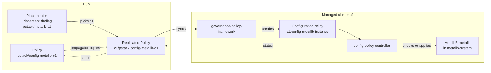

# ACM policies in brief

PolicyStack never applies anything to a managed cluster itself. It renders Red Hat Advanced Cluster Management (ACM) governance objects onto the hub, in namespace `pstack` (created by PolicyStack's install chart, [Where Policies live](policies.md#where-policies-live)), and ACM does the rest: it copies each Policy to the cluster it targets, applies or checks it there, and reports compliance back. An element is one Helm chart under `stack/` (metallb, gitops, …), rendered once per cluster; how its files become these objects is on [How an element is built](elements.md).

## The objects

| Object | Lives in | What it does |
|---|---|---|
| `Policy` | `pstack` on the hub | A wrapper. It holds one or more policy templates, a `remediationAction`, optional `dependencies` and compliance annotations. ACM never applies a Policy directly; it delivers it. |
| Policy template | Inside a Policy, under `spec.policy-templates` | One unit of work. PolicyStack uses two kinds: ConfigurationPolicy and OperatorPolicy. On the hub they are not separate objects, so `oc get configurationpolicy -n pstack` returns nothing; read them in the Policy's YAML. |
| `ConfigurationPolicy` | Created on the managed cluster | Lists Kubernetes objects and how each must compare with the live cluster ([ConfigurationPolicy](#configurationpolicy)). |
| `OperatorPolicy` | Created on the managed cluster | Installs and maintains one OLM operator ([OperatorPolicy](#operatorpolicy)). |
| `Placement` | `pstack` on the hub | Selects managed clusters by label. PolicyStack renders one per element per cluster, selecting only that cluster ([Placement](policies.md#placement)). |
| `PlacementBinding` | `pstack` on the hub | Links Policies to a Placement. A Policy with no binding goes nowhere. |
| `ManagedClusterSet`, `ManagedClusterSetBinding` | Hub | Clusters are grouped into ManagedClusterSets; ACM's built-in set `global` holds every cluster. A Placement only sees clusters from sets bound to its own namespace by a ManagedClusterSetBinding. PolicyStack binds `global` into `pstack` ([Cluster sets](policies.md#cluster-sets)). |

## How a Policy reaches a cluster



Names in this example: the Helm release is `metallb-c1` (`<element>-<cluster>`), Policies are `<policy>-<release>` and templates `<policy>-<template>`, so template names don't carry the cluster ([Rendered names](elements.md#rendered-names)).

1. Argo CD syncs the root Policy (the one from Git; ACM's per-cluster copies are *replicated* Policies) into `pstack` on the hub, with its Placement and PlacementBinding. Look with `oc get policies.policy.open-cluster-management.io -n pstack` (the full resource name, because `policies` can resolve to another policy engine's kind); the compliance column there sums up every cluster the Policy reaches.
2. For each cluster the Placement selects, ACM's policy propagator on the hub copies the Policy into the hub namespace named after the cluster (ACM creates one per managed cluster at import; `local-cluster` for the hub itself), as `<namespace>.<name>`: `pstack.config-metallb-c1` in namespace `c1`. Hub templates are resolved in this step ([Hub and managed-cluster templates](#hub-and-managed-cluster-templates)). Per-cluster compliance is read from this copy. The name doubles as a label value, so it is capped at 63 characters ([Naming limits](policies.md#naming-limits)).
3. Each managed cluster runs two ACM governance add-ons: `governance-policy-framework` copies the replicated Policy into the cluster-named namespace on the managed cluster and creates each policy template there as a real object; `config-policy-controller` evaluates them (next step).
4. `config-policy-controller` compares every ConfigurationPolicy and OperatorPolicy with the live cluster, changes the cluster under `enforce`, and writes compliance into the template's status. The framework sends it back up to the replicated Policy, and the propagator rolls it up into the root Policy.

!!! warning "Template names are per cluster, not per Policy"
    Every template of every Policy placed on a cluster lands in the same namespace there, so two Policies can't ship a template with the same name. The second one reports `Template name must be unique. Policy template with kind: ConfigurationPolicy name: <name> already exists in policy <policy>`. CI catches this before merge (POLICY002 within an element, POLICY003 across elements; [Validator rules](../reference/rules.md)).

This is the `config` Policy of the metallb element as Argo CD syncs it for cluster `c1` (render it with the `helm template` command in [Placement](policies.md#placement), release `metallb-c1`, plus `--set stack.metallb.enabled=true`; without `selector`, the cluster selector the ApplicationSet passes into every Application, the render fails):

```yaml title="Policy pstack/config-metallb-c1"
apiVersion: policy.open-cluster-management.io/v1
kind: Policy
metadata:
  name: config-metallb-c1
  namespace: pstack
  annotations: # (1)!
    policy.open-cluster-management.io/categories: "SC System and Communications Protection"
    policy.open-cluster-management.io/controls: "SC-7 Boundary Protection"
    policy.open-cluster-management.io/standards: "NIST SP 800-53"
spec:
  remediationAction: enforce # (2)!
  disabled: false # (3)!
  copyPolicyMetadata: false # (4)!
  dependencies: # (5)!
    - apiVersion: policy.open-cluster-management.io/v1
      kind: Policy
      name: install-metallb-c1
      namespace: pstack
      compliance: Compliant
  policy-templates:
    - extraDependencies: # (6)!
        - apiVersion: policy.open-cluster-management.io/v1
          kind: ConfigurationPolicy
          name: install-metallb-status
          compliance: Compliant
      ignorePending: true
      objectDefinition:
        apiVersion: policy.open-cluster-management.io/v1
        kind: ConfigurationPolicy
        metadata:
          name: config-metallb-instance
        spec:
          remediationAction: enforce
          severity: medium # (7)!
          object-templates:
            - complianceType: musthave # (8)!
              objectDefinition:
                apiVersion: metallb.io/v1beta1
                kind: MetalLB
                metadata:
                  name: metallb
                  namespace: metallb-system
```

1. Metadata only ([Severity and compliance annotations](#severity-and-compliance-annotations)).
2. Overrides the `remediationAction` of every template below ([inform, enforce and InformOnly](#inform-enforce-and-informonly)).
3. `true` stops ACM delivering the Policy while it stays on the hub. To remove a Policy, see [Removal and pruning](removal.md).
4. Keeps Argo CD's tracking labels off the replicated copies, so Argo CD never sees them as its own and never prunes them.
5. The whole Policy waits until Policy `install-metallb-c1` is Compliant on this cluster ([Dependencies and ignorePending](#dependencies-and-ignorepending)).
6. This one template also waits for the operator's install check.
7. Shown in the console; changes no behavior.
8. The MetalLB object must exist with these fields ([ConfigurationPolicy](#configurationpolicy)).

## ConfigurationPolicy

A ConfigurationPolicy lists objects under `object-templates`. Each entry is an `objectDefinition` (the object, written like a manifest) and a `complianceType` that says how it must compare with the cluster. The controller only looks at the fields you list, except where `mustonlyhave` says otherwise.

| `complianceType` | Compliant when | Under `enforce` |
|---|---|---|
| `musthave` (PolicyStack's default) | The object exists and every listed field matches. Unlisted fields are ignored; a listed list must contain the listed items, and may hold more. | Creates the object, or patches the listed fields. Other fields and list items stay. |
| `mustonlyhave` | The object exists and matches exactly: listed maps and lists hold nothing else, and the object has no top-level field you didn't list (`metadata` and `status` aside). | Creates the object, or replaces those fields and removes the extra ones. Anything another controller added to them is removed on every evaluation. |
| `mustnothave` | No object with that name exists. | Deletes it. |

Take a live ConfigMap `app` with `data: {a: "1", b: "2"}` and a template listing `data: {a: "1"}`: `musthave` is Compliant, `mustonlyhave` is NonCompliant and enforce removes `b`, `mustnothave` is NonCompliant and enforce deletes the ConfigMap.

Two shapes are checks only, whatever the action:

- **An object with no `metadata.name` and no `objectSelector`** matches any object of that kind (in that namespace) with the listed fields. `musthave` is Compliant if one matches, `mustnothave` if none do. ACM can't create or delete by an unknown name, so it evaluates these as `inform`. With `objectSelector`, each selected object is handled by name and `enforce` acts on it.
- **Fields under `status`** are compared but never written; a mismatch stays NonCompliant.

PolicyStack generates one such check per operator, named `install-<key>-status` after the operator's key in the element (`install-metallb-status` for MetalLB): a ClusterServiceVersion with no name, `spec.displayName` set to the operator's display name, and `status.phase: Succeeded`. It turns Compliant once the operator finished installing, which is what other templates wait on.

`object-templates-raw` is the same list written as one string, so [ACM templates on the cluster](#hub-and-managed-cluster-templates) can decide how many objects there are; PolicyStack picks it from the output shape of a converter (an element file that renders a template's objects) ([Converter shapes](../develop/elements.md#converter-shapes)). What happens to objects when a ConfigurationPolicy goes away (`pruneObjectBehavior`) is on [Removal and pruning](removal.md#what-happens-on-the-managed-cluster).

## OperatorPolicy

An OperatorPolicy manages one OLM operator: it creates and maintains the operator's Subscription and OperatorGroup, and approves the InstallPlans OLM proposes (an InstallPlan is OLM's proposal to install or upgrade to a ClusterServiceVersion, one operator version). The fields that matter:

- `complianceType: musthave` keeps the operator installed; `mustnothave` uninstalls it under enforce, as `removalBehavior` says (by default the Subscription and CSV go, the OperatorGroup goes if nothing else uses it, CRDs stay).
- `upgradeApproval` (required): `None` approves the first install only; `Automatic` also approves later upgrades.
- `versions` lists the CSV names it may approve, for the first install and for upgrades. Empty allows any.

The OperatorPolicy owns approval: ACM rejects an OperatorPolicy whose `subscription` sets `installPlanApproval`, and CI fails it first (POLICY030). Under `inform` it approves nothing: a fresh cluster gets no operator, and the Policy reports NonCompliant. Pinning, bumping and uninstalling are on [Operator versions](../guides/operators.md).

## inform, enforce and InformOnly

| Action | Where it is set | What the controller does |
|---|---|---|
| `inform` | Policy | Compares and reports. Never changes the cluster, never approves an InstallPlan. On new config every missing object reads NonCompliant: the list of what `enforce` would change. |
| `enforce` | Policy | Creates, patches or deletes objects until they match, and approves InstallPlans. |
| `InformOnly` | One template | Keeps that template `inform` even when its Policy enforces. |

The Policy's `remediationAction` overrides the action of every template inside it. The only exception is a template set to `InformOnly`, which the add-on turns into `inform` on the cluster. Use it for checks that must never act: a readiness check, or a `mustnothave` that should report an object rather than delete it (the compliance element's findings templates are `mustnothave` ComplianceCheckResults; enforced, ACM would delete the scan results).

Which action each Policy gets, and how to force every Policy to `inform` for a dry run, is on [Inform or enforce](elements.md#inform-or-enforce).

!!! warning "Enforced means applied, not ready"
    An enforced ConfigurationPolicy turns Compliant as soon as the API server accepts the create or patch. It says nothing about whether the operator behind the object finished its work. An OperatorPolicy is the exception: it stays NonCompliant until the CSV reaches `Succeeded` and its deployments are available. Wait on a separate inform check for that, as [Cluster lifecycle](lifecycle.md) does after each step.

## Compliance states

The controller reports a state per template; the add-on rolls them up to the Policy.

| State | Template | Policy |
|---|---|---|
| `Compliant` | The cluster matches. | Every template is Compliant. |
| `NonCompliant` | The cluster differs, a check failed, or the template could not be processed (message starts with `template-error;`). | At least one template is NonCompliant. This wins over Pending. |
| `Pending` | A dependency is unmet, so the template isn't evaluated ([Dependencies and ignorePending](#dependencies-and-ignorepending)). | No template is NonCompliant and at least one is Pending. |

An empty state means nothing has reported. If `oc get policies.policy.open-cluster-management.io -n c1` doesn't list the Policy at all, the Placement selected no cluster: check `oc get placementdecisions -n pstack` and [Cluster sets](policies.md#cluster-sets). If the copy exists but is empty, the cluster hasn't reported, for example because it is unreachable.

Read the reason on the hub, from the replicated Policy:

```sh
# one line per Policy on cluster c1
oc get policies.policy.open-cluster-management.io -n c1
# NAME                        REMEDIATION ACTION   COMPLIANCE STATE   AGE
# pstack.config-metallb-c1    enforce              Compliant          5m
# pstack.install-metallb-c1   enforce              Compliant          6m

# one line per template: name, state, latest message
oc get policies.policy.open-cluster-management.io pstack.config-metallb-c1 -n c1 \
  -o jsonpath='{range .status.details[*]}{.templateMeta.name}{"\t"}{.compliant}{"\t"}{.history[0].message}{"\n"}{end}'
```

Messages name the object and what is wrong with it:

| Message | Means |
|---|---|
| `NonCompliant; violation - metallbs [metallb] not found in namespace metallb-system` | `musthave` under inform, object missing. |
| `NonCompliant; violation - metallbs [metallb] in namespace metallb-system is missing, and cannot be created, reason: ...` | Enforce tried to create it and the API refused. |
| `NonCompliant; violation - metallbs [metallb] found but not as specified in namespace metallb-system` | Exists, a listed field differs. |
| `Compliant; notification - metallbs [metallb] was created successfully in namespace metallb-system` | Enforce created it. |
| `Pending; Dependencies were not satisfied: 1 is still pending (Policy pstack.install-metallb-c1)` | Waiting on a dependency. |
| `Compliant; Dependencies were not satisfied: 2 are still pending (ConfigurationPolicy install-metallb-status, Policy pstack.install-metallb-c1) but ignorePending is true` | Waiting, but reported Compliant because of `ignorePending`: `config-metallb-instance` before the operator is installed. |
| `NonCompliant; template-error; ...` | The template could not be processed, for example a failed hub template. |

On the managed cluster, `oc get configurationpolicies,operatorpolicies -n c1` lists the templates and `oc describe` shows each one's related objects. In the console, the same data is under **Governance**, per Policy and per cluster.

## Dependencies and ignorePending

A dependency makes something wait until another policy object reaches a given compliance state (PolicyStack writes `Compliant` unless the values entry sets `compliance`).

- `spec.dependencies` on a Policy holds back every template in it.
- `extraDependencies` on one policy template holds back that template only.

Either may name a Policy or a template (ConfigurationPolicy, OperatorPolicy) on the same cluster. While a dependency is unmet, the template is `Pending` and does not exist on the managed cluster: the add-on doesn't create it, or **deletes it** if it was there. A dependency that goes NonCompliant later, for example while an operator upgrades and its CSV leaves `Succeeded`, removes the dependent templates until it recovers. With `pruneObjectBehavior`, removing a template also deletes its objects, so every operator upgrade would delete and recreate, for example, the MetalLB instance. That is why PolicyStack rejects `pruneObjectBehavior` on any template with a dependency (POLICY033, [Removal and pruning](removal.md)).

`ignorePending: true` on a template reports a Pending template as Compliant, with the message ending `but ignorePending is true`. The Policy can then read Compliant while the template hasn't run.

In the metallb example, Policy `config` waits for Policy `install`, and its `config-metallb-instance` template also waits for `install-metallb-status`. The waits exist because the MetalLB CRD only exists once the operator is installed. Until then the template is Pending and not created, and because of `ignorePending` the `config` Policy reads Compliant instead of Pending. Check `install-metallb-c1` before trusting a green `config`.

The values keys that render these (`dependencies`, `extraDependencies`, `waitForOperator`, `orderManifests`) are on [How an element is built](elements.md#waiting-and-ordering).

## Severity and compliance annotations

All four are metadata; none changes what ACM does.

- `severity` (`low`, `medium`, `high`, `critical`) sits on each template and shows in the console next to its violations.
- `categories`, `controls` and `standards` become `policy.open-cluster-management.io/*` annotations on the Policy. The Governance dashboard groups Policies by them, so claiming a control the Policy doesn't implement misreports compliance.

## Hub and managed-cluster templates

ACM resolves Go templates inside policy templates, in two places:

| Syntax | Resolved by | When | Can read |
|---|---|---|---|
| `{{hub ... hub}}` | The propagator, on the hub | When it replicates the Policy for each cluster, and again when a hub object the template reads changes | Hub objects in the Policy's namespace (`pstack`), and the target ManagedCluster (`.ManagedClusterName`, `.ManagedClusterLabels`). Other namespaces need `hubTemplateOptions.serviceAccountName` on the Policy, naming a ServiceAccount in `pstack` with read access. |
| `{{ ... }}` | `config-policy-controller`, on the managed cluster | On every evaluation | Objects on that cluster (`lookup`, `fromSecret`, `fromConfigMap`, `fromClusterClaim`). |

Hub templates are how a secret on the hub reaches a cluster without being stored in Git ([Secrets](../develop/elements.md#secrets)). A failed hub template shows on the cluster as a `template-error` on that template. Converters are Helm templates too, so an ACM template inside one is written escaped, for example `{{ "{{" }}hub fromSecret … hub{{ "}}" }}`, so that Helm prints it instead of evaluating it ([Helm templates and ACM templates](elements.md#helm-templates-and-acm-templates)).

## Further reading

- [ACM Governance](https://docs.redhat.com/en/documentation/red_hat_advanced_cluster_management_for_kubernetes/2.16/html/governance/): the policy framework, ConfigurationPolicy, OperatorPolicy, templates and dependencies.
- [ACM Clusters](https://docs.redhat.com/en/documentation/red_hat_advanced_cluster_management_for_kubernetes/2.16/html/clusters/): ManagedClusterSets and Placements.
