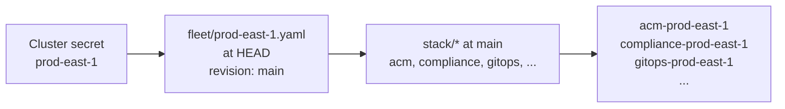

# ApplicationSets

How the hub turns fleet files and `stack/` into Argo CD Applications, and what each Application does. Read it when an Application is missing, has the wrong name, or will not sync. [How PolicyStack works](overview.md) gives the big picture first; [ACM policies in brief](acm.md) covers what happens after the Policies reach `pstack`.

Argo CD deploys only to the hub. Every Application's destination is the hub itself, and everything it syncs is a Policy, Placement or PlacementBinding in `pstack`, the policy namespace the [install chart](../reference/install.md) creates. ACM, not Argo CD, delivers those policies to managed clusters.

## ApplicationSets in brief

An Argo CD **Application** renders one Helm chart from one Git path at one revision and keeps the result applied. An **ApplicationSet** is a template for Applications plus a list of **generators**. Each generator produces sets of parameters, and the ApplicationSet controller creates one Application per parameter set, filling the template with them. It re-runs the generators every 3 minutes. When a parameter set disappears, its Application is deleted.

PolicyStack uses four generator types:

| Generator | Produces one parameter set per | Parameters used here |
|---|---|---|
| `clusters` | Argo CD cluster secret | `.name` (the ManagedCluster name), `.metadata.labels` |
| `git` files | YAML file matching a path | Every top-level key of the file, such as `.revision`, `.valueFiles`, `.hub` |
| `git` directories | Directory matching a path | `.path.path` (`stack/gitops`), `.path.basenameNormalized` (`gitops`) |
| `matrix` | Combination of its two child generators | Both children's parameters. The second child can use the first's, which is how `stack/*` is read at each cluster's own revision. |

A `selector` on a generator drops parameter sets that do not match, like a label selector on the parameters.

The [install chart](../reference/install.md) creates three ApplicationSets in `openshift-gitops`. You apply the first, the **pointer**, by hand once per hub ([Install PolicyStack](../start/install.md#install-policystack)). The pointer's Application `policystack` syncs everything in `install/` from Git, the pointer included:

| ApplicationSet | Creates | Who needs it |
|---|---|---|
| `policystack-install` | Application `policystack`, which renders `install/` at the hub file's `installRevision`, or the default branch when unset ([The pointer](../reference/install.md#the-pointer)). | Everyone. A Global Hub applies it on its `default`-mode child hubs ([Child hubs](../reference/install.md#child-hubs)). |
| `policystack` | One Application per element per cluster: Day-2 configuration of clusters that already run. | Everyone |
| `policystack-lifecycle` | One Application per cluster this hub builds, from fleet files with `hub: <hubName>` ([Cluster lifecycle](lifecycle.md)). | Only hubs that build clusters. Fleet files without `hub` never match it. |

## Cluster secrets

The `clusters` generator lists Argo CD cluster secrets: Secrets in `openshift-gitops` labelled `argocd.argoproj.io/secret-type: cluster`. PolicyStack needs one per ManagedCluster only as an entry in that list. Argo CD never connects to the clusters they describe.

The install chart's GitOpsCluster `argo-acm-importer-global` creates them. ACM puts every ManagedCluster, the hub included, in the built-in ManagedClusterSet `global`. The install chart binds that set into `openshift-gitops` with a ManagedClusterSetBinding, because a Placement only sees clusters from sets bound into its own namespace ([ACM policies in brief](acm.md#the-objects)); its Placement `global` there selects every cluster in it. The GitOpsCluster creates one secret per selected cluster and copies the ManagedCluster's labels onto it, so the generators can read `clusterID`, `local-cluster` and the Global Hub `deploy-mode` label.

The Placement tolerates `unreachable` and `unavailable`. Without that, a cluster that loses contact drops out of the Placement, the GitOpsCluster deletes its secret, and the ApplicationSet deletes its Applications and every Policy they rendered ([What deletes an Application](removal.md#what-deletes-an-application)).

## Generators

### `policystack`

For every cluster secret, the `policystack` ApplicationSet:

1. Keeps it only if it has the `clusterID` label. ACM sets that label once the cluster's klusterlet, the ACM agent on the managed cluster, has joined the hub, so clusters still importing are skipped.
2. Reads the cluster's fleet file from the default branch (`HEAD`). A cluster without a fleet file gets no Applications, and the ApplicationSet reports no error.
3. Lists every directory under `stack/` at the fleet file's `revision`.
4. Creates one Application per directory, named `<element>-<cluster>`.



The fleet file is read at `HEAD`; everything else at its `revision`. [Fleet files](overview.md#fleet-files) explains why.

The cluster secret decides which fleet file is read:

| Cluster secret | Fleet file |
|---|---|
| The hub's own (label `local-cluster`) | `fleet/hubs/<hubName>.yaml` ([The hub](#the-hub)) |
| A managed hub imported into a Global Hub in `default` mode (label `global-hub.open-cluster-management.io/deploy-mode: default`) | `fleet/hubs/<cluster>.yaml` ([Global Hub](../guides/global-hub.md#layout)) |
| Any other cluster | `fleet/<cluster>.yaml` |

Without Global Hub, only the first and last rows apply.

Two consequences of generating from directories:

- **An element exists per revision.** An element added on a branch gets Applications only on clusters whose `revision` contains it.
- **Disabled elements still get an Application.** Generators read files, not merged Helm values, so they cannot tell whether a values layer enabled an element. Every directory under `stack/` gets an Application on every cluster, and a disabled element renders zero objects and shows `Synced` with no resources.

??? example "`policystack` generators, rendered with `hubName=acm-dc1`"

    ```yaml
    generators:
      - matrix:
          generators:
            - matrix:
                generators:
                  - clusters: # (1)!
                      selector:
                        matchExpressions:
                          - key: clusterID
                            operator: Exists
                  - git: # (2)!
                      repoURL: 'https://github.com/acme/policystack.git'
                      revision: HEAD
                      pathParamPrefix: fleet # (3)!
                      files:
                      - path: 'fleet/{{if index .metadata.labels "local-cluster"}}hubs/acm-dc1{{else if eq (index .metadata.labels "global-hub.open-cluster-management.io/deploy-mode") "default"}}hubs/{{.name}}{{else}}{{.name}}{{end}}.yaml'
            - git: # (4)!
                repoURL: 'https://github.com/acme/policystack.git'
                revision: '{{.revision}}'
                directories:
                - path: 'stack/*'
    ```

    1.  Every cluster secret with `clusterID`.
    2.  The cluster's fleet file at `HEAD`, picked by the table above. Its top-level keys become parameters, such as `{{.revision}}`.
    3.  Both git generators emit a `path` parameter. This renames the fleet file's to `fleet.path`, so `{{.path.path}}` and `{{.path.basenameNormalized}}` still mean the element directory, which builds the Application name and source path.
    4.  Every `stack/*` directory at the cluster's `revision`.

### Lifecycle generator

Skip this unless the hub builds clusters.

`policystack-lifecycle` reads fleet files that set `hub`, and creates `lifecycle-<cluster>` for each one this hub should build. That Application renders `lifecycle/` at the fleet file's `revision` into Policies that are placed on the **building hub**, not on the new cluster, which does not exist yet. On the hub they create the HostedCluster, ClusterDeployment or ClusterInstance and wait for it ([Cluster lifecycle](lifecycle.md)).

A fleet file with `hub` renders on exactly one hub:

| Fleet file has | Rendered by | Policies placed on |
|---|---|---|
| `hub: <this hub's hubName>`, and this hub manages itself (`local-cluster` exists) | This hub | `local-cluster` |
| `hub: <name>` of a managed hub that this Global Hub imports in `default` mode | The Global Hub | That managed hub ([Global Hub lifecycle](../guides/global-hub.md#lifecycle)) |
| No `hub` | Nobody. The cluster is imported, not built. | |

A hub whose MultiClusterHub disables self-management has no `local-cluster` secret and builds nothing itself.

??? example "`policystack-lifecycle` generators, rendered with `hubName=acm-dc1`"

    ```yaml
    generators:
      - matrix: # (1)!
          generators:
            - clusters:
                selector:
                  matchExpressions:
                    - key: local-cluster
                      operator: Exists
            - git: &fleet
                repoURL: 'https://github.com/acme/policystack.git'
                revision: HEAD
                files:
                - path: 'fleet/*.yaml'
                - path: 'fleet/*/*.yaml' # (2)!
                  exclude: true
              selector:
                matchExpressions:
                  - key: hub
                    operator: In
                    values:
                      - "acm-dc1"
      - matrix: # (3)!
          generators:
            - git: *fleet
              selector:
                matchExpressions:
                  - key: hub
                    operator: Exists
            - clusters:
                selector:
                  matchLabels:
                    apps.open-cluster-management.io/cluster-name: '{{ if regexMatch "^[a-z0-9]([-a-z0-9]{0,61}[a-z0-9])?$" (toString .hub) }}{{ .hub }}{{ end }}' # (4)!
                    global-hub.open-cluster-management.io/deploy-mode: default
    ```

    1.  Fleet files with `hub: acm-dc1`, paired with this hub's own cluster secret.
    2.  Argo CD's `*` crosses `/`. This drops `hubs/` and other subdirectories, so a hub file is never a lifecycle fleet file.
    3.  Global Hub only: fleet files naming a managed hub imported in `default` mode. Fleet files come first because Argo CD templates a child generator's fields but not its `selector`.
    4.  A `hub` that is not a DNS label matches nothing instead of failing the whole ApplicationSet.

## Applications

| Field | `policystack` | `policystack-lifecycle` |
|---|---|---|
| Name | `<element>-<cluster>`, `<element>-<hubName>` for the hub | `lifecycle-<cluster>` |
| Source | `stack/<element>` at the fleet file's `revision` | `lifecycle/` at the fleet file's `revision` |
| Values files | `values.yaml`, root `values.yaml`, each `valueFiles` entry, `values/clusters/<cluster>.yaml` ([Order](values.md#order)) | Same files |
| Injected values | `selector` for the cluster, `version`, `channel` | `selector` for the building hub, `hub`, `state`, `install`, `version`, `channel` ([Order](values.md#order)) |
| Destination | The hub (`https://kubernetes.default.svc`) | Same |
| Project | `default` | Same |
| Sync | Automated, `prune`, `selfHeal`, `allowEmpty` | Automated, `prune`, `selfHeal` |

The Application name is also the Helm **release** name. The Policy, Placement and PlacementBinding names include it: Policy `install-gitops-prod-east-1`, Placement and PlacementBinding `gitops-prod-east-1`. ConfigurationPolicy and OperatorPolicy names do not ([Rendered names](elements.md#rendered-names)). Renaming an element, a cluster or `hubName` renames the release, so its Policies are deleted and recreated. Where a template prunes, the objects on the cluster are deleted and recreated too ([Removal and pruning](removal.md#what-happens-on-the-managed-cluster)).

What the sync options do, all on the hub:

- **Automated**: every change at the revision syncs without anyone pressing Sync.
- **`prune`**: an object that drops out of the render, such as a policy you set `enabled: false`, is deleted from `pstack`.
- **`selfHeal`**: a hand edit to a Policy or Placement in `pstack` is reverted to what Git renders.
- **`allowEmpty`**: Argo CD normally refuses an automated sync that would leave an Application with no objects. This lets a disabled element prune to zero ([Removal and pruning](removal.md)). Lifecycle Applications leave it off: `lifecycle/` always renders the `present` or `absent` Policy, so an empty render can only be an error, and Argo CD refuses to prune everything.

The destination namespace, `open-cluster-management`, is unused. Every rendered object sets its own namespace, `policyNamespace` (`pstack`).

??? example "Application `compliance-prod-east-1`"

    ```yaml title="fleet/prod-east-1.yaml"
    revision: main
    channel: stable-4.20
    valueFiles:
      - environments/prod.yaml
      - datacenters/dc1.yaml
      - platforms/aws.yaml
    ```

    renders:

    ```yaml
    apiVersion: argoproj.io/v1alpha1
    kind: Application
    metadata:
      name: compliance-prod-east-1
      namespace: openshift-gitops
      labels:
        velero.io/exclude-from-backup: "true" # (1)!
      annotations:
        argocd.argoproj.io/manifest-generate-paths: '.;../../lib;../../values.yaml;../../values/environments/prod.yaml;../../values/datacenters/dc1.yaml;../../values/platforms/aws.yaml;../../values/clusters/prod-east-1.yaml' # (2)!
      finalizers:
        - resources-finalizer.argocd.argoproj.io # (3)!
    spec:
      project: default
      source:
        repoURL: 'https://github.com/acme/policystack.git'
        targetRevision: main
        path: stack/compliance
        helm:
          ignoreMissingValueFiles: true # (4)!
          valueFiles:
            - values.yaml
            - ../../values.yaml
            - ../../values/environments/prod.yaml
            - ../../values/datacenters/dc1.yaml
            - ../../values/platforms/aws.yaml
            - ../../values/clusters/prod-east-1.yaml
          valuesObject:
            channel: "stable-4.20"
            policystack:
              libraryMajors: [4] # (5)!
            selector: # (6)!
              matchExpressions:
                name:
                  key: name
                  operator: In
                  values:
                    - "prod-east-1"
      destination:
        server: 'https://kubernetes.default.svc'
        namespace: open-cluster-management
      syncPolicy:
        syncOptions:
          - RespectIgnoreDifferences=true # (7)!
        automated:
          prune: true
          selfHeal: true
          allowEmpty: true
    ```

    1.  Kept out of ACM backup ([Install chart](../reference/install.md#backup-and-restore)).
    2.  [Render cache](#render-cache).
    3.  Added by the ApplicationSet controller because `preserveResourcesOnDeletion` is `false`. Deleting the Application deletes its objects in `pstack`.
    4.  A listed file that does not exist is skipped without an error ([Missing files](values.md#missing-files)).
    5.  The policy-library majors this hub supports. A revision built on another major fails its render ([Order](values.md#order)).
    6.  Becomes the element's single-cluster Placement ([Placement](policies.md#placement)).
    7.  No effect: no Application sets `ignoreDifferences`.

## When an Application fails

Two different steps can fail, with different blast radius:

| Step | What runs | Typical cause | What you see | Effect |
|---|---|---|---|---|
| Generation | The ApplicationSet controller evaluates its generators. | A fleet file that does not parse, lacks `revision`, or pins a revision that does not exist. | `ErrorOccurred` condition on the ApplicationSet | No Application is created, updated or deleted until it is fixed; existing ones keep their Policies ([One bad fleet file stops the hub](overview.md#one-bad-fleet-file-stops-the-hub)). |
| Render | Argo CD runs `helm template` for one Application. | A values key the schema rejects, a `policies.<p>` naming a policy that has no converter, or a `revision` whose policy-library major the hub's install chart doesn't support. | `ComparisonError` on that Application, sync status `Unknown` | That Application neither syncs nor prunes; its Policies stay as they were. A converter error affects one element. A schema error in a layer fails every Application that reads the layer, all elements and `lifecycle-<cluster>` included ([Schema](values.md#schema)). |

A render error carries the Helm message. With `stack.gitops.policies.bogus.enabled: true` in a layer:

```text
policy-library: policies.bogus has no templates - add converters/bogus/<template>.yaml
```

```sh
oc get applicationset policystack -n openshift-gitops \
  -o jsonpath='{.status.conditions[?(@.type=="ErrorOccurred")].message}'
oc get application gitops-prod-east-1 -n openshift-gitops \
  -o jsonpath='{.status.conditions[?(@.type=="ComparisonError")].message}'
```

Your repository's CI renders every element for every fleet file and checks every pin, so both normally fail the PR instead of the hub ([Validation](../develop/validation.md)).

## Deletion

`policystack` and `policystack-lifecycle` set `preserveResourcesOnDeletion: false`, so each Application gets Argo CD's resources finalizer and deleting it deletes its Policies, Placement and PlacementBinding from `pstack`. Applications are deleted when their generator stops producing them, for example when a fleet file is deleted ([What deletes an Application](removal.md#what-deletes-an-application)). ACM then removes the policies from the cluster; what they created stays unless a template prunes ([What happens on the managed cluster](removal.md#what-happens-on-the-managed-cluster)). No lifecycle template prunes, so deleting `lifecycle-<cluster>` leaves the cluster running, unmanaged ([Abandon](../guides/lifecycle.md#abandon)).

The pointer's Application `policystack` is the exception: it has no finalizer and never prunes, so deleting it, or a merged change that drops an install object, deletes nothing ([Deletion safety](../reference/install.md#deletion-safety)).

Every Policy sets `copyPolicyMetadata: false`, so Argo CD never treats ACM's replicated copies as its own and never prunes them ([Removal and pruning](removal.md)).

## Render cache

Background; nothing to configure.

Each Application lists the files its render reads in [`manifest-generate-paths`](https://argo-cd.readthedocs.io/en/stable/operator-manual/high_availability/#manifest-paths-annotation). Paths are relative to the source path, `stack/<element>`: `.` is the element directory, `../../lib` is the policy-library chart (Helm reads it from Git through `file://`), and `../../` is the repo root. For a new commit, Argo CD compares the changed files with this list, with or without a webhook, and reuses the cached render when none match.

A commit to `values/clusters/prod-east-1.yaml` therefore re-renders only prod-east-1's Applications, and a commit to `stack/compliance/` only the `compliance-*` Applications at that revision. A commit to the root `values.yaml` or to `lib/` re-renders all of them, `lifecycle-*` included (its paths start at `lifecycle/`, so the library is `../lib`). Fleet files are not listed: a fleet change alters the Application spec, which always re-renders.

## The hub

ACM manages the hub as a ManagedCluster too, named `local-cluster` by default and labelled `local-cluster`. PolicyStack configures it like any cluster, with one difference: it is known by `hubName`, the name you give it when you apply the pointer ([Install chart](../reference/install.md#values)). The secret with the `local-cluster` label switches the generator to the hub's names:

| | Managed cluster | Hub |
|---|---|---|
| Fleet file | `fleet/<cluster>.yaml` | `fleet/hubs/<hubName>.yaml` ([Hub file](../reference/fleet.md#hub-file)) |
| Cluster values file | `values/clusters/<cluster>.yaml` | `values/clusters/<hubName>.yaml` |
| Applications (releases) | `<element>-<cluster>` | `<element>-<hubName>` |
| Policies in `pstack` | `<policy>-<element>-<cluster>` | `<policy>-<element>-<hubName>` |
| Placement selector | `name In [<cluster>]` | `name In [<hub's ManagedCluster name>]`, `local-cluster` by default |
| Replicated Policies | Namespace `<cluster>` | The hub's ManagedCluster namespace, `local-cluster` by default |
| Lifecycle fleet files it builds | | Those with `hub: <hubName>` |

For the hub's compliance, run `oc get policies.policy.open-cluster-management.io -n local-cluster` (or the MultiClusterHub's `localClusterName`), not `-n <hubName>`. The ManagedCluster keeps its ACM name; `hubName` changes only what PolicyStack derives from Git.

??? question "Why not use the cluster name?"
    Nothing on a hub is both stable and unique. Every hub's own ManagedCluster is `local-cluster` unless the MultiClusterHub sets `localClusterName`, so hubs reading one repo would collide. `clusterID` is unique but changes when a hub is rebuilt or replaced, which would rename every hub Application. A name you choose stays put. `fleet/hubs/` keeps hub files apart from a managed cluster that happens to have the same name.

### Several hubs, one repo

Each hub only sees cluster secrets for the ManagedClusters it imports. `fleet/prod-east-1.yaml` therefore renders only on the hub that manages prod-east-1, and a lifecycle fleet file only on the hub its `hub` names. Every active hub needs its own `hubName`, because they all share the name `local-cluster`. Two active hubs with the same `hubName` both read `fleet/hubs/<hubName>.yaml` and both try to build every cluster whose fleet file names that hub.

A DR hub is the exception: it does not run PolicyStack while passive, and at takeover you apply the pointer on it with the `hubName` of the hub it replaces, so it reads the same hub file and adopts the restored clusters ([Hub disaster recovery](../guides/lifecycle.md#hub-disaster-recovery)).

A managed hub imported into a Global Hub in `default` mode has no `local-cluster`. The Global Hub reads `fleet/hubs/<cluster>.yaml` for it and names its Applications `<element>-<cluster>`. Name its ManagedCluster after its `hubName` so both modes read the same file ([Global Hub](../guides/global-hub.md#import-modes)). The Global Hub also installs PolicyStack on it, with the ManagedCluster name as `hubName` ([Child hubs](../reference/install.md#child-hubs)).

### Changing `hubName`

!!! warning
    The hub's Applications are renamed, so they and their Policies are deleted and recreated under the new name. Fleet files with `hub: <old>` stop matching; their `lifecycle-<cluster>` Applications are deleted and those clusters keep running, unmanaged, until the fleet files name the new hub.

Check the current value with `oc get applicationset policystack-install -n openshift-gitops -o jsonpath='{.spec.template.spec.source.helm.valuesObject}'`. To change it:

1. Merge copies of `fleet/hubs/<old>.yaml` and `values/clusters/<old>.yaml` under the new name, and change `hub: <old>` to the new name in lifecycle fleet files.
2. Re-apply the pointer with the new name and the same `gitRepo` (and `repoSecret`, if set): `helm template policystack ./install --show-only templates/install.yaml --set hubName=<new> --set gitRepo=<url> | oc apply -f -` ([Install PolicyStack](../start/install.md#install-policystack)). Check it with the command above; if it still shows the old name, apply it again ([Values](../reference/install.md#values)).
3. Delete the old files.

A Global Hub child's `hubName` is its ManagedCluster name on the parent, so it changes only with that name.
