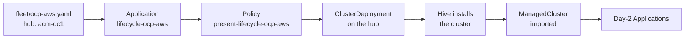
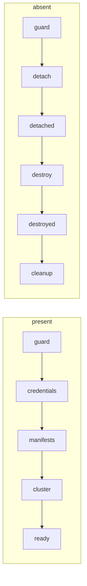

# Cluster lifecycle

Lifecycle is how a hub builds and destroys clusters from fleet files (`fleet/<cluster>.yaml`, one per cluster, saying which Git revision and values layers it gets: [Fleet files](overview.md#fleet-files)). You add `hub`, `version` and an `install` block to a cluster's fleet file and merge to the default branch, the only branch fleet files are read from. The hub you named creates the cluster with ACM's own installers and imports it. From then on the same fleet file gives it Day-2 config (the element Policies that configure a running cluster), like any imported cluster. Set `state: absent` and the hub destroys it.

A cluster whose fleet file has no `hub` is one you build and import yourself. Lifecycle never touches it.

PolicyStack adds no controller for this. The `lifecycle/` chart renders only an ACM Policy, a Placement and a PlacementBinding. The install itself is done by components that ship with ACM and its multicluster engine (MCE): HyperShift, Hive, or SiteConfig with the assisted or image-based installer. You provide the credential Secret on the hub ([Install keys](../reference/lifecycle.md#install-keys)), plus a BMC Secret for `siteconfig` and the InfraEnv and Agents for `hypershift` on `Agent` ([Examples](../guides/lifecycle.md#examples)). Steps: [Building clusters](../guides/lifecycle.md). Keys: [Lifecycle keys](../reference/lifecycle.md).

## Fleet keys

`hub:` in a fleet file names the building hub by its `hubName` ([Words with more than one meaning](overview.md#words-with-more-than-one-meaning)).

Five fleet-file keys drive lifecycle. Only Application `lifecycle-<cluster>` ([below](#how-a-policy-builds-a-cluster)) reads `hub`, `state` and `install`; the per-element Day-2 Applications ignore them. `revision` and `valueFiles` work as for any cluster: `revision` also pins which `lifecycle/` chart renders, and layers can set `install` defaults.

| Key | What it does |
|---|---|
| `hub` | The `hubName` of the hub that builds the cluster, as set at `helm install` on that hub. That hub also imports it. CI fails (POLICY050) when `fleet/hubs/<hub>.yaml` does not exist, which catches typos. |
| `state` | `present` (default) builds the cluster, then keeps applying the changes the engine accepts ([Immutable fields](#immutable-fields)). `absent` destroys it. |
| `version` | OpenShift release, `x.y.z`. Required while `state: present`: the render fails with `version is required`. Bumping it upgrades the cluster ([OpenShift upgrades](../guides/upgrades.md#how-it-works)). |
| `channel` | Upgrade channel, such as `stable-4.20`. Optional. On `hypershift`, a bump waits until the channel's update graph offers `version` ([Upgrades](../guides/lifecycle.md#upgrades)). |
| `install` | What to build: [engine](#pick-an-engine), credential, domain, nodes. Any [values layer](values.md) can set `install` defaults; the fleet file's `install` wins over every layer. |

`version` and `channel` go only in the fleet file. The two ApplicationSets (`policystack` for Day-2, `policystack-lifecycle`) pass them from there to the lifecycle chart and to the `upgrade` element, the Day-2 element that upgrades a running cluster. A layer value would silently upgrade every cluster that reads the layer, so CI rejects it (POLICY034, [why](../guides/upgrades.md#how-it-works)).

The fleet file name is the cluster name: a DNS label of at most 30 characters, so every element's Policy names fit ([Naming limits](policies.md#naming-limits)).

## Pick an engine

`install.engine` picks which ACM component builds the cluster. Never change it on an existing cluster: destroy first, otherwise the hub can build a second cluster with the same name ([Changing `engine`](#ownership)).

| You want | `install.engine` | `install.platform` | Upgraded by |
|---|---|---|---|
| OpenShift on AWS, GCP, Azure or vSphere | `hive` | | [`upgrade`](../guides/upgrades.md#the-upgrade-element) element on the cluster |
| OpenShift on bare metal with a BMC | `siteconfig` | | [`upgrade`](../guides/upgrades.md#the-upgrade-element) element on the cluster |
| Hosted control plane, workers as VMs on the hub | `hypershift` (default) | `KubeVirt` | `lifecycle-<cluster>` on the hub, on a `version` bump |
| Hosted control plane, bare-metal workers | `hypershift` | `Agent` | `lifecycle-<cluster>` on the hub, on a `version` bump |
| Hosted control plane, workers you boot yourself | `hypershift` | `None` | `lifecycle-<cluster>` on the hub, on a `version` bump |

- **`hypershift`** creates a HostedCluster and NodePools. The control plane runs as pods on the hub, so the hub upgrades it. `install.platform` has no default: leave it out and the render fails with `install.platform is required`. Set it in the fleet file or a layer, as upstream's example `values/platforms/kubevirt.yaml` and `agent.yaml` do.
- **`hive`** creates a ClusterDeployment, and Hive runs the OpenShift installer against your cloud or vCenter. It ignores `install.platform`; the cloud goes in `install.hive.platform.<aws|gcp|azure|vsphere>`.
- **`siteconfig`** creates a ClusterInstance. SiteConfig boots your hosts through their BMCs and installs them with the assisted installer (`ai`, default) or from a seed image (`ibi`, single node).

## How a Policy builds a cluster



1. On the hub whose `hubName` matches `hub`, ApplicationSet `policystack-lifecycle` creates Application `lifecycle-<cluster>` in `openshift-gitops`. Fleet files are read at the head of the default branch; the Application renders `lifecycle/` at the fleet file's `revision`, so a change to the lifecycle chart reaches only clusters whose revision contains it.
2. The render is a Placement and PlacementBinding `lifecycle-<cluster>` and one Policy in `pstack`, the hub namespace that holds every PolicyStack Policy ([Where Policies live](policies.md#where-policies-live)): `present-lifecycle-<cluster>`, or `absent-lifecycle-<cluster>` when `state: absent`. Flipping `state` makes Argo CD delete one and create the other; deleting a lifecycle Policy removes nothing from the hub ([Why Policies](#why-policies)).
3. The Placement selects the hub's own ManagedCluster (`local-cluster` by default). ACM copies the Policy into namespace `local-cluster`, and the governance add-on on the hub evaluates it against the hub's own API. Nothing is placed on the new cluster; it does not exist yet.
4. The Policy's steps create the engine's objects on the hub. The engine builds the cluster from them.
5. ACM imports the finished cluster, and the Day-2 ApplicationSet takes over ([Day-2 handoff](#day-2-handoff)).

The cluster is built when `present-lifecycle-<cluster>` is Compliant. Compliant does not mean its Day-2 elements have applied; those are separate Policies.

!!! warning "The hub must manage itself"
    The lifecycle ApplicationSet only runs on a hub that is registered as its own ManagedCluster, `local-cluster`, which ACM does by default. Without it, no `lifecycle-<cluster>` Application appears and nothing reports an error. Check with `oc get managedcluster -l local-cluster`. The one exception is a hub imported into Multicluster Global Hub in default mode, which has no `local-cluster`: the global hub renders the Application and places the Policy on that hub ([Global Hub](../guides/global-hub.md#lifecycle)).

### Worked example

`fleet/ocp-aws.yaml` with a copy of upstream's example `platforms/aws.yaml` layer (full example in [Building clusters](../guides/lifecycle.md#examples)):

```yaml
# fleet/ocp-aws.yaml
revision: main
hub: acm-dc1
version: 4.20.8
channel: stable-4.20
valueFiles:
  - platforms/aws.yaml      # engine: hive, credential hive-credentials/aws, machine sizes
install:
  baseDomain: aws.example.com
  hive:
    platform:
      aws:
        region: us-east-2
```

renders on hub `acm-dc1`:

```text
Application openshift-gitops/lifecycle-ocp-aws
├ Placement, PlacementBinding pstack/lifecycle-ocp-aws    selects local-cluster
└ Policy pstack/present-lifecycle-ocp-aws                 enforce
  ├ present-guard-ocp-aws        InformOnly  refuses a same-named cluster it did not build
  ├ present-credentials-ocp-aws  enforce     Namespace ocp-aws; Secrets ocp-aws-pull-secret,
  │                                          ocp-aws-creds, ocp-aws-install-config
  ├ present-manifests-ocp-aws    enforce     install.manifests (none here)
  ├ present-cluster-ocp-aws      enforce     ClusterDeployment ocp-aws/ocp-aws, ManagedCluster ocp-aws,
  │                                          KlusterletAddonConfig ocp-aws/ocp-aws
  └ present-ready-ocp-aws        InformOnly  ClusterDeployment spec.installed: true
```

Hive then installs the cluster, about 45 minutes on AWS.

### Why Policies

Argo CD could apply a ClusterDeployment from Git. A Policy evaluated on the hub can do four things Argo CD cannot:

- **Keep secrets out of Git.** You create the credential Secret (a console credential works) and, for `siteconfig`, the BMC Secret on the hub by hand. The `credentials` step copies their keys into per-cluster Secrets with `fromSecret`, an ACM template function that reads a Secret when the Policy is evaluated. The Policy is evaluated on the hub itself, so they can sit in any hub namespace. Edits reach the copies on the next evaluation. Lifecycle never deletes them.
- **Run steps in order** and wait on the engine's status between them ([The step chain](#the-step-chain)).
- **Read live fields back.** The Hive release image, the SiteConfig ClusterImageSet image and the ClusterInstance `sshPublicKey` are read from the live objects, so a later `version` bump never hits an immutable field ([Immutable fields](#immutable-fields)).
- **Refuse what it did not build**, checked in the same evaluation as each write ([Ownership](#ownership)).

No lifecycle template sets `pruneObjectBehavior`, the ACM setting that deletes a Policy's objects when the Policy is deleted ([Removal and pruning](removal.md)). Deleting a lifecycle Policy therefore deletes nothing on the hub. Only `state: absent` destroys a cluster.

## The step chain

Each step is a ConfigurationPolicy inside the Policy, named `<state>-<step>-<cluster>`, such as `present-guard-hcp-kubevirt`. The `-<cluster>` suffix comes from the policy-library option `suffixTemplateNames: true`: every lifecycle Policy lands on the same hub, and ACM requires template names to be unique across all Policies on one cluster.

The lifecycle chart lists the steps in `orderManifests`, a policy-library key that makes each step depend on the one before it being Compliant ([Waiting and ordering](elements.md#waiting-and-ordering)). Until it is, ACM does not evaluate the step and reports it Pending.



| Step | Mode | Does |
|---|---|---|
| `guard` | InformOnly | NonCompliant while a same-named cluster exists that lifecycle did not build ([Ownership](#ownership)). Stops the chain. |
| `credentials` | enforce | Namespace and the Secrets copied from the credential. |
| `manifests` | enforce | `install.manifests`: extra hub objects, such as a MetalLB address pool the cluster's API needs. |
| `cluster` | enforce | The engine's objects: HostedCluster and NodePools, ClusterDeployment, or ClusterInstance. |
| `ready` | InformOnly | Waits for the install, or a HyperShift upgrade, to finish. |
| `detach` | enforce | Deletes the ManagedCluster while the cluster still runs, so ACM's agents clean up. |
| `detached` | InformOnly | Waits for the ManagedCluster to be gone. |
| `destroy` | enforce | Deletes the engine's root object; the engine then deletes the cluster. |
| `destroyed` | InformOnly | Waits for the root object to be gone. |
| `cleanup` | enforce | Deletes the copied Secrets or Namespace `<cluster>`, and `install.manifests`. |

The InformOnly steps are gates. An enforced create or delete is Compliant as soon as the API accepts it, long before the engine finishes, so each enforced step that hands work to an engine is followed by a gate that checks the engine's status. InformOnly is a template-level action ACM never enforces, even inside an enforced Policy ([ACM policies in brief](acm.md#inform-enforce-and-informonly)), so a gate never changes anything.

`siteconfig` has no `detach` or `detached`: SiteConfig owns the ManagedCluster and would re-create it. Per-engine detail for every step: [Policy chains](../reference/lifecycle.md#policy-chains).

!!! info "NonCompliant during a build is normal"
    `present-ready-<cluster>` stays NonCompliant with `Waiting for …` until the install finishes, and on `hypershift` during every upgrade; Argo CD shows `lifecycle-<cluster>` Degraded. Diagnosis: [Watching a build](../guides/lifecycle.md#watching-a-build), [When a build fails](../guides/lifecycle.md#when-a-build-fails).

!!! warning "Dry run applies to lifecycle"
    `global.remediationAction: inform` in any layer the cluster reads turns the lifecycle Policy to inform too ([Dry run](../guides/rollout.md#dry-run)). The hub then builds nothing, and `state: absent` destroys nothing.

## Ownership

Lifecycle acts only on clusters it built. Without this, adding `hub` to the fleet file of an imported or console-built cluster with the same name would let the hub patch that cluster's objects, and `state: absent` would destroy a cluster PolicyStack never built.

The `cluster` step writes the annotation `lifecycle.policystk.io/hub: <hubName>` (the marker) on the engine's root object in the same create. The root object is the engine object whose deletion destroys the cluster:

| Engine | Root object | Also marked |
|---|---|---|
| `hypershift` | HostedCluster `<install.namespace>/<cluster>` | |
| `hive` | ClusterDeployment `<cluster>/<cluster>` | ManagedCluster `<cluster>` |
| `siteconfig` | ClusterInstance `<cluster>/<cluster>` | ManagedCluster `<cluster>`, through `extraAnnotations` |

Each evaluation checks the first of these that exists:

1. the root object;
2. ManagedCluster `<cluster>`;
3. `siteconfig` only: ClusterDeployment `<cluster>/<cluster>`, which SiteConfig would adopt.

If it lacks the marker, it is foreign. The others are not checked, so a `hypershift` cluster's ManagedCluster, which the hypershift-addon creates without the marker, never counts once the HostedCluster exists. A marked ManagedCluster with no root object, as after a failed ClusterDeployment create, is owned.

When an object is foreign:

- `guard` goes NonCompliant and names it, which stops the chain.
- Every enforced step except `manifests` repeats the check in the same evaluation and fails with `<Kind> <cluster> was not built by lifecycle (no lifecycle.policystk.io/hub annotation); refusing`. A stale guard result can therefore never let a step write or delete. `manifests` writes hub objects not tied to the cluster name, so it skips the check, but it runs only after `credentials` passed it.

Only the key counts; the value records the hub that last wrote it. A root object restored onto a new hub, as in [hub disaster recovery](../guides/lifecycle.md#hub-disaster-recovery), stays owned. An imported cluster is never adopted: remove `hub`, `state` and `install` from its fleet file.

!!! warning "Not marked: Namespace and hypershift Secrets"
    Namespace `<cluster>` and the `hypershift` Secrets carry no marker. A same-named Namespace or Secret created after a destroy, with no root object left, is deleted by a still-present `absent` Policy, so delete the fleet file once a destroy finishes. Only `install.namespace` is checked for a HostedCluster: a same-named HostedCluster in another namespace is not seen, and lifecycle builds a second one whose ManagedCluster name collides. Keep HostedCluster names unique on the hub.

!!! warning "Changing `engine`"
    The lookup starts at the new engine's root object, so it can miss an engine switch. Switching from `hive` to `hypershift` or `siteconfig`, or from `siteconfig` to `hypershift`, finds the old engine's marked ManagedCluster, so the guard passes and the hub builds a second cluster under the same name while the first keeps running. Other switches are refused, because the new root object or the ManagedCluster exists without the marker. Destroy before changing `engine`.

## Immutable fields

Most `install` keys are fixed at create, because the engine's API rejects changes to the fields they set. Changing one never rebuilds the cluster. The `cluster` step tries the update, the API denies it, and `present-cluster-<cluster>` goes NonCompliant with the API's message while the live object stays as it was. The update is all or nothing: while the denial stands, no other change to that object goes through either, including a `version` bump on a HostedCluster and every node change on a ClusterInstance.

To recover, revert the value, or destroy and build again. Which fields are fixed per object: [Immutable fields](../reference/lifecycle.md#immutable-fields).

What does apply after create: `version` and `channel` on `hypershift`, NodePool `replicas` and new pools, `siteconfig` worker add and remove, `manifests`, and the credential's contents. Everything else: check the [table](../reference/lifecycle.md#immutable-fields).

`siteconfig` is the strictest. Its ClusterInstance is [`mustonlyhave`](acm.md#configurationpolicy), so the whole rendered spec must match, and SiteConfig refuses almost every change after install. A shared layer change or a new `revision` whose `lifecycle/` renders the ClusterInstance differently is denied on every evaluation. Before moving a `siteconfig` cluster to a new `revision`, render both and compare the ClusterInstance.

## Destroy and abandon

**Destroy** removes the cluster. Set `state: absent` and keep `install` and every layer that sets it; without them the absent Policy targets the wrong engine ([Destroy](../guides/lifecycle.md#destroy)).

The absent chain:

1. `detach` deletes the ManagedCluster while the cluster still runs, so ACM's agents remove themselves. The cluster leaves Argo CD, and its Day-2 Applications and hub Policies are deleted.
2. `destroy` deletes the root object. HyperShift deletes the control plane and NodePools; Hive deprovisions the cloud resources with `<cluster>-creds`; SiteConfig deletes the BareMetalHosts, then the ManagedCluster.
3. `cleanup` deletes the copied Secrets or Namespace `<cluster>`, the `siteconfig` ClusterImageSet, and `install.manifests`. The credential stays.

The cluster is gone when `absent-lifecycle-<cluster>` is Compliant. Then delete the fleet file: a lingering `absent` Policy deletes any Namespace `<cluster>` created later ([Not marked](#ownership)). Or set `state: present` to build a new cluster under the same name. Procedure and what each engine leaves behind: [Destroy](../guides/lifecycle.md#destroy).

**Abandon** stops lifecycle without touching the cluster. Delete the fleet file, or remove `hub`, `state` and `install` together. Application `lifecycle-<cluster>` and its Policy are deleted, and since no lifecycle template prunes, the cluster keeps running and stays an ACM ManagedCluster.

- Removing only `hub` while the fleet file still sets `state` or `install` fails CI (POLICY050). If `install` comes only from layers, CI passes and the cluster is abandoned.
- Removing the keys keeps the cluster's Day-2 Applications. Deleting the whole fleet file deletes them too ([Removal and pruning](removal.md)).
- Deleting the fleet file while `absent-lifecycle-<cluster>` is not yet Compliant abandons the cluster halfway through destroy.

Restore the keys with the same `install` to re-adopt it: the root object still carries the marker. Changing `hub` abandons the cluster on the old hub, and the new hub builds a second one unless the root object was moved there with its marker ([Abandon](../guides/lifecycle.md#abandon)).

## Day-2 handoff

A cluster the hub builds gets Day-2 config the same way as an imported one:

1. The ManagedCluster appears. `hypershift`: the hypershift-addon creates it once the HostedCluster is available, and runs the cluster's klusterlet (ACM's agent for that cluster) on the hub in hosted mode. `hive`: the `cluster` step created it, and ACM imports it once Hive marks the install done. `siteconfig`: SiteConfig created it, and ACM imports it.
2. Like every ManagedCluster, it joins ACM's `global` ManagedClusterSet. The install chart's GitOpsCluster turns that into an Argo CD cluster secret ([Install chart](../reference/install.md)). Once the cluster reports in, ACM labels it with its `clusterID`, and only then does the Day-2 ApplicationSet select it, so a cluster still installing gets no Day-2 Applications.
3. The Day-2 ApplicationSet pairs the secret with the same fleet file and creates one `<element>-<cluster>` Application per element, at the fleet file's `revision` with its `valueFiles`.

`hive` and `siteconfig` render their own KlusterletAddonConfig with every add-on on, replacing SiteConfig's stock one, which turns off the application manager that ACM needs to create the cluster's Argo CD secret.
