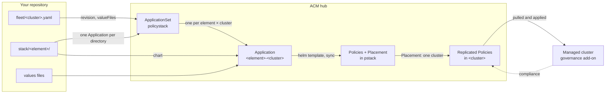

# PolicyStack

PolicyStack configures OpenShift clusters from Git through Red Hat Advanced Cluster Management (ACM) governance policies. It is for admins who run an ACM hub and want every cluster's operators and settings reviewed in Git, rolled out cluster by cluster, and reported as compliant or not. It adds no controller of its own: a Helm chart points the hub's OpenShift GitOps (Argo CD) at your repository, and ACM does the rest.

You create your own repository from PolicyStack's releases with copier, describe each cluster in it, and turn on the elements you want. An element is a Helm chart under `stack/` that configures one product, such as cert-manager, MetalLB or the Compliance Operator.

## How it works

1. You edit Git. Each cluster has a fleet file, `fleet/<cluster>.yaml`, that picks the revision (branch, tag or commit) the cluster renders from and the values files it reads. Values files turn elements on and set their options.
2. Argo CD on the hub renders each element once per cluster into ACM Policies, using that cluster's revision and values, and writes them to the `pstack` namespace on the hub.
3. Each Policy targets exactly one cluster. ACM's governance add-on on that cluster enforces the Policy or only reports differences, and ACM shows the compliance result on the hub.

| Box | What it is |
|---|---|
| `fleet/<cluster>.yaml` | One file per cluster, read from the default branch. Without it the cluster gets nothing ([Fleet files](concepts/overview.md#fleet-files)). |
| `stack/<element>/` | The elements, read at the revision the fleet file pins ([How an element is built](concepts/elements.md)). |
| values files | On top of the element's own defaults: the root `values.yaml`, then the layers the fleet file lists, then `values/clusters/<cluster>.yaml`. Later files win ([Values cascade](concepts/values.md)). |
| ApplicationSet `policystack` | Installed once per hub. Creates one Argo CD Application per element for each ACM managed cluster on this hub that has a fleet file ([ApplicationSets](concepts/architecture.md)). |
| Application `<element>-<cluster>` | Renders one element for one cluster with Helm and syncs the result to the hub. |
| Policies + Placement in `pstack` | The rendered ACM objects. The Placement selects only this cluster ([ACM policies in brief](concepts/acm.md)). |
| Replicated Policies in `<cluster>` | ACM's copy of each Policy in the cluster's namespace on the hub. Where you read that cluster's compliance. |
| Governance add-on | ACM's policy controllers on the managed cluster. They apply the Policy (`enforce`) or only report differences (`inform`), and send the status back. |

The install chart also creates a second ApplicationSet, `policystack-lifecycle`, which builds and destroys clusters whose fleet file has `hub:` ([Cluster lifecycle](concepts/lifecycle.md)). It does nothing for clusters you import.

## Why it works this way

- Each cluster gets one Application per element, rendered from that cluster's own revision and values files, so a commit reaches a cluster only through them. You promote a change cluster by cluster and roll back by moving the pin back ([Rolling out changes](guides/rollout.md)).
- Elements render ACM Policies instead of plain manifests. A Policy can enforce its state or only report drift, and every cluster's compliance is visible on the hub. For a dry run, set `global.remediationAction: inform` in a values layer: every Policy of the clusters reading that layer becomes report-only ([Dry run](guides/rollout.md#dry-run)).
- Argo CD writes Policies to the hub only and never deploys to managed clusters. Each cluster's governance add-on pulls its own Policies, the same way ACM delivers every policy.

!!! tip "New here?"
    Skim [How PolicyStack works](concepts/overview.md) before installing. It maps the repository, what lives on the hub, how a commit reaches a cluster, and the terms the rest of the docs use. Installation and First cluster link the other concept pages where they need them.

## Documentation

| Section | Read it when | Start at |
|---|---|---|
| Get started | You create your repository and set up a hub, then onboard a cluster | [Installation](start/install.md) |
| Concepts | You want to know how the parts fit and why | [How PolicyStack works](concepts/overview.md) |
| Guides | You run a hub: rollouts, operator versions, building clusters, upgrades | [Rolling out changes](guides/rollout.md) |
| Elements | You configure an element | Its [`stack/<element>/README.md`](https://github.com/PolicyStack/PolicyStack/tree/main/stack) on GitHub; [ACS](elements/acs.md) and [Compliance](elements/compliance.md) have guides |
| Develop | You write or change an element | [Writing an element](develop/elements.md) |
| Reference | You look up a key, label, rule or workflow | [Fleet files](reference/fleet.md) |
| Contributing | You change the framework itself | [Contributing](contributing.md) |
