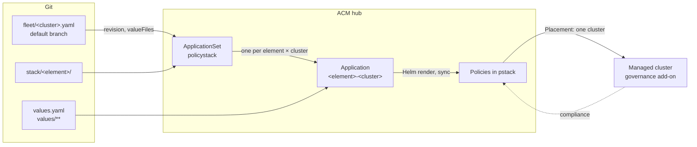

# PolicyStack

PolicyStack keeps OpenShift cluster configuration in Git as Red Hat Advanced Cluster Management (ACM) policies. Each directory under `stack/` is an element: a Helm chart that renders policies through the [policy-library](https://github.com/PolicyStack/PolicyStack-chart/blob/main/charts/policy-library/README.md) chart. On the hub, an Argo CD ApplicationSet creates one Application per element for each cluster that has a fleet file. Argo CD syncs the policies to the hub only, and ACM delivers each one to the single cluster it targets.



A fleet file pins a cluster to a Git revision and lists its values layers:

```yaml
# fleet/prod-east-1.yaml
revision: main # (1)!
valueFiles: # (2)!
  - environments/prod.yaml
  - datacenters/dc1.yaml
  - platforms/aws.yaml
```

1.  Branch, tag or SHA. Every Application for this cluster renders from it.
2.  Files under `values/`, lowest precedence first. `values/clusters/prod-east-1.yaml` is always added last.

!!! tip
    Add `hub: <hubName>` and the hub also builds the cluster with HyperShift, Hive or SiteConfig, and destroys it on `state: absent`. See [Cluster lifecycle](lifecycle.md).

## How a change reaches a cluster

1. **Commit** to the revision the cluster pins. Here, turning on `gitops` for one cluster:

    ```diff
    # values/clusters/prod-east-1.yaml
     stack:
    +  gitops:
    +    enabled: true
    ```

    Clusters pinned to other revisions are unaffected. Fleet file edits count only on the default branch.

2. **Argo CD renders** the element with the cluster's [values cascade](values.md#order) and syncs Policy, PolicySet, Placement and PlacementBinding into `pstack` on the hub.
3. **ACM delivers.** The [Placement](policies.md#placement) selects only that cluster, and its governance add-on applies the policy: `enforce` changes the cluster, `inform` only reports. Compliance shows on the replicated Policy in the cluster's namespace on the hub.

## Terms

| Term | Meaning |
|---|---|
| [Element](elements.md) | A `stack/<element>/` Helm chart that depends on policy-library. Its values define the policies it renders. |
| [Fleet file](applicationset.md#fleet-files) | `fleet/<cluster>.yaml`, or `fleet/hubs/<hubName>.yaml` for the hub, on the default branch. Sets the revision, the values files and optionally the hub that builds the cluster. |
| [Hub](applicationset.md#the-hub) | The cluster running ACM and OpenShift GitOps. Holds the ApplicationSets, Applications, Policies and the control planes it builds. ACM manages it as `local-cluster`, so you give it a fleet file too, at `fleet/hubs/<hubName>.yaml`. |
| [Managed cluster](rollout.md#onboarding-a-cluster) | A cluster ACM manages, imported by hand or built by a hub. The GitOpsCluster imports it into Argo CD; it gets one Application per element once it also has a fleet file. |
| [Release](applicationset.md#applications) | The Application name, also the Helm release name: `<element>-<cluster>`, or `<element>-<hubName>` on the hub. Policy and Placement names derive from it. |
| [Revision](applicationset.md#revision) | The branch, tag or SHA in a fleet file. All of the cluster's Applications render from it. |
| [Values cascade](values.md#order) | The ordered values files Helm gets for one Application. Later files override earlier ones. |

## Where to go next

- [Installation](install.md): install the operators and PolicyStack on a hub.
- [Rolling out changes](rollout.md): onboard a cluster, promote, roll back, remove an element.
- [Values cascade](values.md): how values layers merge.
- [Writing an element](elements.md): add your own configuration.
- [Cluster lifecycle](lifecycle.md): build and destroy clusters from Git.
