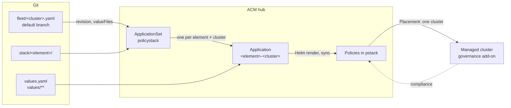

# PolicyStack

PolicyStack keeps OpenShift cluster configuration in Git as Red Hat Advanced Cluster Management (ACM) policies. Each directory under `stack/` is an element: a Helm chart that renders policies through the [policy-library](https://github.com/PolicyStack/PolicyStack-chart/blob/main/charts/policy-library/README.md) chart. Its `converters/<policy>/<template>.yaml` files and `operatorPolicies` define the policies; values configure them. On the hub, an Argo CD ApplicationSet creates one Application per element for each cluster that has a fleet file. Argo CD syncs the policies to the hub only, and ACM delivers each one to the single cluster it targets.

## Documentation

| Section | Read it when | Start at |
|---|---|---|
| Get started | You are setting up a hub | [Installation](start/install.md) |
| Concepts | You want to know how a commit reaches a cluster | [Architecture](concepts/architecture.md) |
| Guides | You run a hub: rollouts, upgrades, cluster lifecycle | [Rolling out changes](guides/rollout.md) |
| Elements | You configure an element | Its [`stack/<element>/README.md`](https://github.com/PolicyStack/PolicyStack/tree/main/stack) on GitHub; [ACS](elements/acs.md) and [Compliance](elements/compliance.md) have guides |
| Develop | You write or change an element | [Writing an element](develop/elements.md) |
| Reference | You look up a key, rule or workflow | [Fleet files](reference/fleet.md) |
| Contributing | You change the framework itself | [Contributing](contributing.md) |
