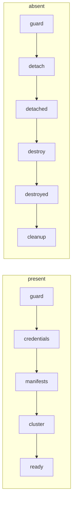

# Lifecycle reference

Details behind [Cluster lifecycle](lifecycle.md). Chart: [`lifecycle/`](https://github.com/PolicyStack/PolicyStack/tree/main/lifecycle).

## Install keys

Defaults are in [`lifecycle/values.yaml`](https://github.com/PolicyStack/PolicyStack/blob/main/lifecycle/values.yaml). The schema rejects unknown keys, and rejects `hive` or `siteconfig` keys unless `engine` selects them.

| Key | Default | Notes |
|---|---|---|
| `engine` | `hypershift` | `hypershift`, `hive` or `siteconfig`. Fixed at create. |
| `credential.namespace`, `.name` | required | Hub Secret with `pullSecret`, `ssh-publickey`, and for `hive` the cloud keys (vSphere: `username`, `password`, `cacertificate`). Any namespace. |
| `baseDomain` | `""` | Required except on `KubeVirt`, which uses the hub's ingress domain. Fixed at create. |
| `releaseRepository` | `quay.io/openshift-release-dev/ocp-release` | Image is `<releaseRepository>:<version>-multi`, `-x86_64` on `siteconfig`. Point at a mirror when disconnected. |
| `manifests` | `[]` | Extra hub objects with `apiVersion`, `kind`, `metadata`. Created before the cluster, deleted after it. |

=== "hypershift"

    | Key | Default | Notes |
    |---|---|---|
    | `platform` | required | `KubeVirt`, `Agent` or `None`. Fixed at create. |
    | `namespace` | `clusters` | HostedCluster, NodePools and copied secrets. Control plane runs in `<namespace>-<cluster>`. |
    | `agentNamespace` | `""` | InfraEnv and Agents. Required on `Agent`. |
    | `services` | `APIServer: LoadBalancer`, others `Route` | Service to `servicePublishingStrategy`. HyperShift needs all four. Fixed at create. |
    | `hostedCluster` | `{}` | `metadata` and `spec` merged over the generated HostedCluster. `spec.release` is ignored. |
    | `nodePools` | `{}` | Pool to NodePool `spec`, merged over the generated one. Named `<cluster>-<pool>`. |

    `hcp-agent` after the cascade merges `platforms/agent.yaml`, [`values/clusters/hcp-agent.yaml`](https://github.com/PolicyStack/PolicyStack/blob/main/values/clusters/hcp-agent.yaml) and its fleet file, trimmed:

    ```yaml
    install:
      platform: Agent                    # (1)!
      agentNamespace: hardware-inventory
      credential:
        namespace: hcp-credentials
        name: hostinventory
      services:
        APIServer:
          type: LoadBalancer
          loadBalancer:
            hostname: api-int-hcp-agent.dc1.example.com
        OAuthServer:
          type: Route                    # (2)!
        Konnectivity:
          type: Route
        Ignition:
          type: Route
      hostedCluster:
        spec:
          kubeAPIServerDNSName: api-hcp-agent.dc1.example.com
      nodePools:
        compute:                         # (3)!
          replicas: 3
          platform:
            agent:
              agentLabelSelector:
                matchLabels:
                  example.com/class: fc830
      manifests:
        - apiVersion: metallb.io/v1beta1 # (4)!
          kind: IPAddressPool
          metadata:
            name: hcp-agent-apiserver
            namespace: metallb-system
          spec:
            addresses:
              - 10.20.9.13/32
    ```

    1.  From `platforms/agent.yaml`. Every layer of the values cascade can set `install`.
    2.  Maps merge with the defaults, so setting only `APIServer` keeps the other three. `null` drops an entry.
    3.  NodePool `hcp-agent-compute`. A pool without `agentLabelSelector` claims any free Agent in `agentNamespace`.
    4.  Exists before the HostedCluster, so MetalLB has the address when the kube-apiserver Service asks for one.

=== "hive"

    | Key | Default | Notes |
    |---|---|---|
    | `hive.platform` | required | Exactly one of `aws`, `gcp`, `azure`, `vsphere`. Needs `region`; GCP adds `projectID`, Azure `baseDomainResourceGroupName`. vSphere is the installer's `platform.vsphere`: needs `vcenters` and `failureDomains`, refuses `user`/`password`. Fixed at create. |
    | `hive.installConfig` | `{}` | Merged under the generated install-config. Hive drops fields its installer does not know. |
    | `hive.clusterDeployment` | `{}` | `metadata` and `spec` merged over the generated ClusterDeployment. `spec.provisioning.releaseImage` is ignored. |

    ```yaml
    # values/platforms/aws.yaml, trimmed
    install:
      engine: hive
      credential:
        namespace: hive-credentials
        name: aws                       # (1)!
      hive:
        installConfig:
          controlPlane:
            name: master
            replicas: 3
            platform:
              aws:
                type: m6i.xlarge
          networking:
            networkType: OVNKubernetes

    # fleet/hive-aws.yaml
    install:
      baseDomain: aws.example.com
      hive:
        platform:
          aws:
            region: us-east-2           # (2)!
    ```

    1.  Holds `pullSecret`, `ssh-publickey`, `aws_access_key_id`, `aws_secret_access_key`.
    2.  Goes to both the install-config and the ClusterDeployment.

=== "siteconfig"

    | Key | Default | Notes |
    |---|---|---|
    | `siteconfig.templates` | `ai` | `ai` (assisted installer) or `ibi` (image-based, single node). Fixed at create. |
    | `siteconfig.templateNamespace` | `open-cluster-management` | Namespace of the stock `<templates>-cluster-templates-v1` and `<templates>-node-templates-v1` ConfigMaps. |
    | `siteconfig.bmcCredential.namespace`, `.name` | required | Hub Secret with `username` and `password`, copied to `<cluster>-bmc`. |
    | `siteconfig.machineNetwork` | | Node subnets. Required with `ai` and one master. |
    | `siteconfig.apiVIPs`, `.ingressVIPs` | | Required with more than one master, forbidden with one. Up to 2 (dual-stack), the same number in each. |
    | `siteconfig.clusterNetwork` | installer default | `{cidr, hostPrefix}` list. |
    | `siteconfig.serviceNetwork` | installer default | Subnets. |
    | `siteconfig.ntpSources` | | Extra NTP sources. |
    | `siteconfig.proxy` | | `httpProxy` and/or `httpsProxy`, `noProxy`. |
    | `siteconfig.extraManifests` | | ConfigMap names in namespace `<cluster>`, from `install.manifests`. |
    | `siteconfig.nodes` | required | hostName to the keys below. Layers merge per host. |

    | Node key | Default | Notes |
    |---|---|---|
    | `bmcAddress` | required | `redfish-`, `idrac-` or `ilo5-virtualmedia`, with optional `+http`/`+https`; `ilo4-virtualmedia`, optional `+https`. |
    | `bootMACAddress` | required | Quote it. |
    | `role` | `master` | `master`, `worker` or `arbiter`. |
    | `rootDeviceHints` | | BareMetalHost hints. `deviceName` takes `/dev/` or `/dev/disk/by-path/` only. |
    | `network` | | Static install network: `interfaces` (NIC name to MAC) and `config` (nmstate). Day 2 is `nmstate`. |
    | `remove` | | `true` on a worker [scales it in](#scaling-siteconfig-workers). |

    All of it is fixed at create; afterwards you can only add and remove workers. `ai` takes 1 or 3 masters, or 2 or more with an arbiter (4.19+). `ibi` takes one node and no VIPs, `clusterNetwork` or `serviceNetwork`. Anything else fails the render.

    ```yaml
    # values/platforms/baremetal.yaml
    install:
      engine: siteconfig
      credential:
        namespace: bm-credentials
        name: hostinventory
      siteconfig:
        bmcCredential:
          namespace: bm-credentials
          name: bmc

    # fleet/sno-edge.yaml
    install:
      siteconfig:
        machineNetwork: [10.20.30.0/24]
        nodes:
          sno-edge.dc1.example.com:     # (1)!
            bmcAddress: redfish-virtualmedia://10.20.0.11/redfish/v1/Systems/1
            bootMACAddress: "00:11:22:33:44:55"
    ```

    1.  The key becomes `hostName`.

## Generated objects

`<cluster>` is the fleet file name. Everything not listed uses the operator's defaults. Override it in `hostedCluster` or `hive.clusterDeployment`. `siteconfig` takes only the keys above; any other key fails the render.

=== "hypershift"

    | Object | Content |
    |---|---|
    | HostedCluster `<namespace>/<cluster>` | Release image, `pullSecret` `<cluster>-pull-secret`, `sshKey` `<cluster>-ssh-key`, platform, `services`, `channel` and `dns.baseDomain` when set. `Agent` adds `agentNamespace`. `Agent` and `None` add `secretEncryption` with `<cluster>-etcd-encryption-key`. |
    | NodePool `<namespace>/<cluster>-<pool>` | `clusterName`, release image, platform, `management.upgradeType` (`Replace` on `KubeVirt`, else `InPlace`). No `replicas` means 0. |

    !!! warning "etcd encryption key"
        Generated once, while neither the key nor the HostedCluster exists. A deleted key is never regenerated: a new key cannot decrypt etcd. Restore it from backup.

=== "hive"

    | Object | Content |
    |---|---|
    | ClusterDeployment `<cluster>/<cluster>` | `baseDomain`, `clusterName`, platform with `credentialsSecretRef` `<cluster>-creds`, `pullSecretRef`, `installConfigSecretRef` `<cluster>-install-config`, release image, `installAttemptsLimit: 1` (a failed install is not retried). vSphere: `infrastructure` is `hive.platform.vsphere` with a blank login, plus `certificatesSecretRef` `<cluster>-certs`. |
    | Secret `<cluster>-creds` | Only the keys Hive reads: `aws_access_key_id` + `aws_secret_access_key`, `osServiceAccount.json`, `osServicePrincipal.json`, or `username` + `password`. |
    | Secret `<cluster>-certs` | vSphere: `.cacert` from `cacertificate`. The login goes only into `<cluster>-install-config`. |
    | ManagedCluster `<cluster>`, KlusterletAddonConfig | Every add-on on. |

=== "siteconfig"

    | Object | Content |
    |---|---|
    | ClusterImageSet `lifecycle-<cluster>` | The release image. |
    | ClusterInstance `<cluster>/<cluster>` | The keys above, plus `clusterName`, `baseDomain`, `pullSecretRef`, `sshPublicKey`, templates, `clusterImageSetNameRef`, per node `hostName`, `bmcCredentialsName` `<cluster>-bmc` and node templates. `clusterType` follows the masters: 1 is `SNO`, an arbiter `HighlyAvailableArbiter`, else `HighlyAvailable`. SiteConfig defaults `bootMode: UEFI`, `automatedCleaningMode: disabled`. |
    | KlusterletAddonConfig | Every add-on on. The stock `ai` one turns application-manager off, so ACM would never create the Argo CD secret. The chart suppresses it and renders its own. |

Hive rejects release image changes, and SiteConfig any spec change before install completes. No webhook guards the `siteconfig` ClusterImageSet. The chart reads those fields back from the live objects, so a `version` bump or credential rotation never touches them, and a hand edit to the image set is kept. Those clusters upgrade through [`upgrade`](upgrades.md).

## Policy chains

The hub gets `present-lifecycle-<cluster>` or `absent-lifecycle-<cluster>`, picked by `state`. Each template waits for the one before it to be Compliant.



Templates are named `<state>-<step>-<cluster>`, e.g. `present-guard-hcp-kubevirt`. `siteconfig` has no `detach` or `detached`.

`present-lifecycle-<cluster>`:

| Template | Mode | `hypershift` | `hive` | `siteconfig` |
|---|---|---|---|---|
| `guard` | InformOnly | NonCompliant while something named `<cluster>` lacks the [marker](#ownership). Stops the chain. | same | same |
| `credentials` | enforce | Namespace `install.namespace`, `<cluster>-pull-secret`, `<cluster>-ssh-key`, etcd key on `Agent`/`None` | Namespace `<cluster>`, `-pull-secret`, `-creds`, `-install-config`, `-certs` on vSphere | Namespace `<cluster>`, `-pull-secret`, `-bmc`. Fails on an empty BMC `username` or `password`. |
| `manifests` | enforce | `install.manifests` | same | same |
| `cluster` | enforce | HostedCluster, NodePools | ClusterDeployment, ManagedCluster, KlusterletAddonConfig | ClusterImageSet, ClusterInstance, KlusterletAddonConfig |
| `ready` | InformOnly | `version` is the desired and newest Completed version, and on every NodePool | `spec.installed: true` | `Provisioned` True and every host joined (Agent stage `Done`) or removed. Names the pending host's BareMetalHost while it exists, otherwise the ClusterInstance. |

`absent-lifecycle-<cluster>`:

| Template | Mode | `hypershift` | `hive` | `siteconfig` |
|---|---|---|---|---|
| `guard` | InformOnly | Same check | same | same |
| `detach` | enforce `mustnothave` | Deletes the ManagedCluster while the cluster is up, so the klusterlet cleans up | same | none: SiteConfig would re-create it |
| `detached` | InformOnly `mustnothave` | Waits for the ManagedCluster to go | same | none |
| `destroy` | enforce `mustnothave` | Deletes the HostedCluster | Deletes the ClusterDeployment; Hive deprovisions with `<cluster>-creds` (and `-certs` on vSphere) | Deletes the ClusterInstance and what it rendered |
| `destroyed` | InformOnly `mustnothave` | Waits for the HostedCluster to go | Waits for deprovision | Waits for the ClusterInstance to go |
| `cleanup` | enforce | Copied secrets, etcd key, `install.manifests` | Namespace `<cluster>`, `install.manifests` | Namespace `<cluster>`, ClusterImageSet, `install.manifests` |

- An enforced delete is Compliant once the API accepts it, so every destroy step has an inform wait after it.
- Create templates are `musthave`: operator-filled fields are not compared, so the Policy never fights HyperShift or Hive. The ClusterInstance alone is `mustonlyhave` with `metadataComplianceType: musthave`, since `musthave` would append a changed node as a duplicate.
- The credential is never deleted.
- Every enforced step but `manifests` repeats the ownership check in the same evaluation and fails on a foreign object, so a stale guard result never lets it write or delete.

!!! note
    No lifecycle template sets `pruneObjectBehavior`. Deleting the present Policy deletes nothing; only `state: absent` destroys.

## Day-2 handoff

1. The ManagedCluster appears. `hypershift`: the hypershift-addon creates it once the HostedCluster is available. `hive`, `siteconfig`: ACM imports the one the chart or SiteConfig created.
2. It joins `global`, the GitOpsCluster creates its Argo CD secret, and ACM adds the `clusterID` label ([Install PolicyStack](install.md#install-policystack)).
3. The Day-2 ApplicationSet pairs the secret with the same fleet file and creates `<element>-<cluster>` Applications. It ignores `hub`, `state` and `install`.

Labels in `hostedCluster.metadata.labels` are copied to the ManagedCluster once, at creation.

??? info "HyperShift auto-import disabled"
    Auto-import is on by default. `autoImportDisabled` in the `hypershift-addon-deploy-config` AddOnDeploymentConfig leaves a built cluster without Day-2 until you import it by hand.

## Ownership

Lifecycle acts only on what it built: objects carrying the annotation `lifecycle.policystk.io/hub: <hubName>`, written by `present-cluster-<cluster>` in the create itself. Only the key counts; the value records the last hub, so a restored or migrated object stays owned.

| Engine | Root object | Also marked |
|---|---|---|
| `hypershift` | HostedCluster `<namespace>/<cluster>` | |
| `hive` | ClusterDeployment `<cluster>/<cluster>` | ManagedCluster |
| `siteconfig` | ClusterInstance `<cluster>/<cluster>` | ManagedCluster, through `extraAnnotations` |

Foreign is the first of these that exists without the marker: the root object, else ManagedCluster `<cluster>`, else for `siteconfig` ClusterDeployment `<cluster>/<cluster>`, which SiteConfig would adopt. A marked ManagedCluster without a root, as after a failed ClusterDeployment create, is owned.

!!! note
    Namespace `<cluster>` and the `hypershift` secrets are not marked. A same-named Namespace or secret created after a destroy, with no root object left, is deleted by a still-present `absent` Policy. Only `install.namespace` is checked for a HostedCluster, so keep HostedCluster names unique on the hub.

## Immutable fields

The operators reject changes to these, among others:

| Object | Immutable |
|---|---|
| HostedCluster | `services`, `platform`, `networking`, `etcd`, `issuerURL`, `controllerAvailabilityPolicy`, `fips`, `dns.baseDomain` once set. `secretEncryption` cannot be removed. |
| NodePool | `clusterName`, `platform.type`, `arch`, `management.upgradeType` |
| ClusterDeployment | Everything but `installAttemptsLimit`, `powerState`, `preserveOnDelete` and a few others. `hive.installConfig` changes reach the Secret, not the cluster. On vSphere all of `hive.platform.vsphere`. |
| ClusterInstance | Everything until install completes. After: only `extraAnnotations`, `extraLabels`, `suppressedManifests`, `pruneManifests`, and adding a node. |

Changing one does not change the cluster: `present-cluster-<cluster>` goes NonCompliant with the API server's message. Revert the value.

- NodePool `upgradeType` or `arch`: add a new pool, remove the old one.
- Any `siteconfig` key on a live cluster, including a field of an existing worker: `unauthorized changes in immutable fields` (cluster keys) or `unauthorized change to …` (host keys). Only adding and removing workers is allowed.
- Any spec edit before the install completes: `spec update not allowed during provisioning or cluster reinstalls`. It applies by itself once the install completes.
- Failed SiteConfig install: set `state: absent`, then build again with the fix.

While a denial stands, no other node change reaches that cluster.

!!! warning "Changing the rendered spec"
    The ClusterInstance is `mustonlyhave`, so a chart or key change that alters the render of an installed cluster is denied on every evaluation. Rebuild the cluster or keep the render identical. A hand-set `spec.reinstall` stays NonCompliant the same way, and a SiteConfig webhook outage turns installed clusters NonCompliant until it returns.

## Removing a NodePool

`musthave` never deletes. Removing an entry only stops managing it. Remove the `nodePools` entry, then:

```sh
oc delete nodepool <cluster>-<pool> -n clusters
```

A pool from a shared layer, like `workers` in `platforms/kubevirt.yaml`, cannot be removed from a higher layer (the schema rejects `null`). Scale it down:

```yaml
install:
  nodePools:
    workers:
      replicas: 0
```

## Scaling SiteConfig workers

!!! note
    Red Hat documents this flow for `clusterType: SNO`. On `HighlyAvailable`, SiteConfig accepts the same changes and its sample output shows it, but no doc covers it explicitly.

**Scale out.** Add a host with `role: worker`. It reaches the ClusterInstance once the install completes, so one-master clusters can list workers from the start. The hub needs a valid kubeconfig for the cluster; if the API certificate changed, [update it first](https://docs.redhat.com/en/documentation/red_hat_advanced_cluster_management_for_kubernetes/2.16/html/clusters/). Keep the `bmcCredential` Secret on the hub: without it `credentials` fails and `cluster` never applies the change. `present-ready` stays NonCompliant until the host's Agent reports `Done`, and names the host once its BareMetalHost exists.

**Scale in.** Set `remove: true` on the worker. Masters and arbiters cannot be removed.

```yaml
install:
  siteconfig:
    nodes:
      w0.bm-ha.dc1.example.com:
        role: worker
        bmcAddress: redfish-virtualmedia://10.20.0.24/redfish/v1/Systems/1
        bootMACAddress: "00:11:22:33:44:04"
        remove: true
```

The `cluster` step then runs SiteConfig's documented scale-in, each write gated on the last:

| Step | Written to the node | Waits for |
|---|---|---|
| 1 | `extraAnnotations` `remove-agent-and-node-on-delete` | The annotation on the BareMetalHost |
| 2 | `pruneManifests`: BareMetalHost, InfraEnv, NMStateConfig | BareMetalHost gone, SiteConfig done (`observedGeneration`) |
| 3 | Node dropped | |

BMAC drains the Node, deprovisions the host and removes the Agent and Node. Follow it with `oc get bmh,agent -n <cluster>`. Once `present-ready` is Compliant, delete the fleet entry. Cleaning is metadata only: data stays on the disks.

| You do | Result |
|---|---|
| Delete a live node's entry, or rename it | `cluster` fails with `not install.siteconfig.nodes`: SiteConfig would accept the drop and delete nothing, stranding the BareMetalHost, Agent and Node. |
| Add a master to a live cluster | `cluster` fails: `is a new master`. |
| Clear `remove` before step 2 | Scale-in cancelled. |
| Clear `remove` after step 2 | `cluster` fails: `cannot be cancelled`. |
| `remove` on a worker still joining | `cluster` fails: `has not finished joining`. Its drain would loop until SiteConfig's 30-minute timeout pauses the ClusterInstance. |
| `remove` on a worker whose Node you already deleted | Not detected: the hub cannot see spoke Nodes. The drain fails the same way, and the BareMetalHost's drain-status annotation shows `failed to drain node`. |

??? warning "Removing a worker that never joined, or whose Node is gone"
    Either finish the install, or annotate its BareMetalHost so the drain gives up. BMAC honours this annotation, but no Red Hat doc covers it:

    ```sh
    oc annotate bmh <host> -n <cluster> bmac.agent-install.openshift.io/drain-timeout=5m
    ```

    The value is a Go duration, counted from the first drain attempt. If the ClusterInstance has already paused, also remove its paused annotation.

## Troubleshooting

Start with the Application for render errors (missing `version`, credential or required key), then the Policy:

```sh
oc get applications.argoproj.io lifecycle-<cluster> -n openshift-gitops -o jsonpath='{.status.conditions}'
```

| Symptom | Cause | Fix |
|---|---|---|
| Guard or any step: "`<Kind> <cluster>` ... not built by lifecycle (no lifecycle.policystk.io/hub annotation); refusing" | Imported, built by hand or the console, or built before the marker. Usually `hub` was added to an imported cluster's fleet file. | Remove `hub`, `state`, `install` from the fleet file. If lifecycle built it, [annotate the root object](lifecycle.md#abandon). |
| `present-credentials` NonCompliant, template error | Credential Secret missing | Create it. Without `pullSecret` the API rejects the pull secret. |
| Cluster has no SSH key, no error | `ssh-publickey` missing from the credential | Add it. |
| `hive`/`siteconfig`: `present-credentials-<cluster>` NonCompliant: `because it is being terminated` | Namespace `<cluster>` from the last destroy is still terminating | Wait until `oc get ns <cluster>` returns NotFound. |

!!! warning "Switching engines"
    The guard looks for the new engine's root object, not the old one's, so it can miss an engine switch. Destroy before changing `engine`.

??? failure "Hive: install failed"
    `present-ready` stays NonCompliant, ClusterDeployment shows `ProvisionStopped`. Read the installer log, fix the values, destroy and build again.

    `RequirementsMet` False with `InstallConfigValidationFailed`: the install-config and ClusterDeployment regions differ, through `hive.clusterDeployment` or an edit of `hive.platform` during install. Revert it.

    A cloud key missing from the credential is copied as an empty value and fails the install.

??? failure "Hive: vSphere credentials rejected"
    ClusterDeployment `AuthenticationFailure` True: the hub could not log in to vCenter with `<cluster>-creds` and `<cluster>-certs`. Check for a wrong login, a trailing newline, a `cacertificate` that is not PEM, vCenter on a port other than 443, or no route from the hub. Right after create it can be brief while the trust bundle fills.

    `RequirementsMet` False, "install config does not contain username/password": the credential is missing `username` or `password`.

    `cluster` NonCompliant with `must specify vSphere vCenter`: the hub's Hive predates zonal vSphere support. Upgrade MCE.

??? failure "Hive: deprovision stuck"
    `absent-destroyed` stays NonCompliant; ClusterDeployment shows `DeprovisionLaunchError`, or the ClusterDeprovision `AuthenticationFailure`. Fix the keys in `<cluster>-creds` (or `<cluster>-certs` on vSphere) directly: the absent Policy no longer copies the credential.

    With HiveConfig `deleteProtection: enabled`:

    ```sh
    oc annotate clusterdeployment <cluster> -n <cluster> hive.openshift.io/protected-delete-
    ```

??? failure "SiteConfig: rejected or failed"
    `present-cluster` shows a webhook denial, or the ClusterInstance shows `Provisioned` False:

    ```sh
    oc get clusterinstance <cluster> -n <cluster> -o jsonpath='{.status.conditions}'
    ```

    Check the AgentClusterInstall too. Destroy, fix, build again. A wrong ref, like `templateNamespace`, can be fixed by creating the missing object. Check `ready-cim-<hub>` for a hub problem.

??? failure "SiteConfig: cluster never imported"
    The hub cannot resolve `api.<cluster>.<baseDomain>`. Add the DNS record where the hub resolves it.

??? failure "SiteConfig: deletion paused"
    The ClusterInstance has `clusterinstance.siteconfig.open-cluster-management.io/paused`: a rendered object (usually a BareMetalHost or the ManagedCluster) was not gone within 30 minutes. Fix what holds it, then remove the annotation.

??? failure "ManagedCluster stuck Terminating"
    `absent-detached` stays NonCompliant. Hosted-mode cleanup waits for the guest; ACM gives up after 5 minutes unreachable. Check:

    ```sh
    oc get klusterlet klusterlet-<cluster> -o jsonpath='{.metadata.finalizers}'
    ```

    If it waits on `operator.open-cluster-management.io/klusterlet-hosted-cleanup` and the guest will not answer, remove that finalizer.

??? failure "Agent: Machines stuck Deleting"
    Machines in `<namespace>-<cluster>` stay `Deleting`, `PreTerminateDeleteHookSucceeded` reports `WaitingExternalHook`. Remove the hook:

    ```sh
    for m in $(oc get machines.cluster.x-k8s.io -n clusters-<cluster> -o name); do
      oc annotate "$m" -n clusters-<cluster> pre-terminate.delete.hook.machine.cluster.x-k8s.io/agentmachine-
    done
    ```

??? failure "Agent: stuck reclaiming"
    After destroy, Agents go to `reclaiming` while they reboot into discovery. One that cannot ends in `UnbindingPendingUserAction`: boot it from the discovery ISO by hand. Agents still holding the `agent.agent-install.openshift.io/ai-deprovision` finalizer block any new cluster that selects them.

## Adding an engine

An engine `<e>` is a component of `lifecycle/`. `templates/policy.yaml` renders whichever component `install.engine` names, so the ApplicationSet and fleet keys do not change.

1. Add `converters/<e>/`: objects to create, `root.yaml` (the root object by identity alone, for destroy and ownership), and its credentials. `lookup` back every field the engine rejects changes to. End the cleanup converter with `include "lifecycle.cleanupManifests"`.
2. Add `stack.<e>` to `values.yaml` with `present` and `absent` Policies following the [chains](#policy-chains). Set every gate to `InformOnly`, which ACM keeps inform under a Policy-level `enforce`. No `pruneObjectBehavior`: it lets a Policy delete a cluster.
3. Add `<e>` to the `install.engine` enum in `values.schema.json`, with its keys. POLICY090 fails when the enum and `stack` keys differ ([Rules](validation.md#rules)).
4. Merge `lifecycle.marker` into the root object's annotations in the cluster converter, and start every enforced converter but `manifests` with `include "lifecycle.refuse"`. Add the engine to `TestOwnership`, a present and an absent fleet file to `tools/validator/testdata/clusters/`, and an example to [Cluster lifecycle](lifecycle.md).

An engine that upgrades from the hub maps `version` onto its objects, like `hypershift`. One that only installs uses `version` at create and leaves upgrades to `upgrade` ([Upgrades](upgrades.md)).
